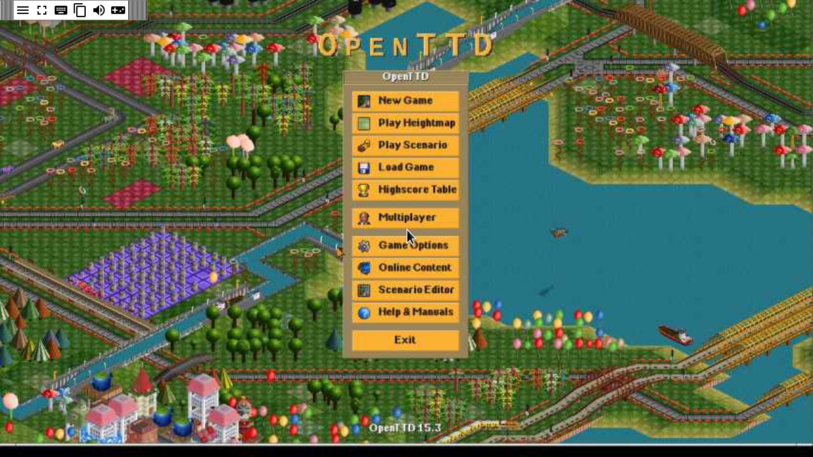
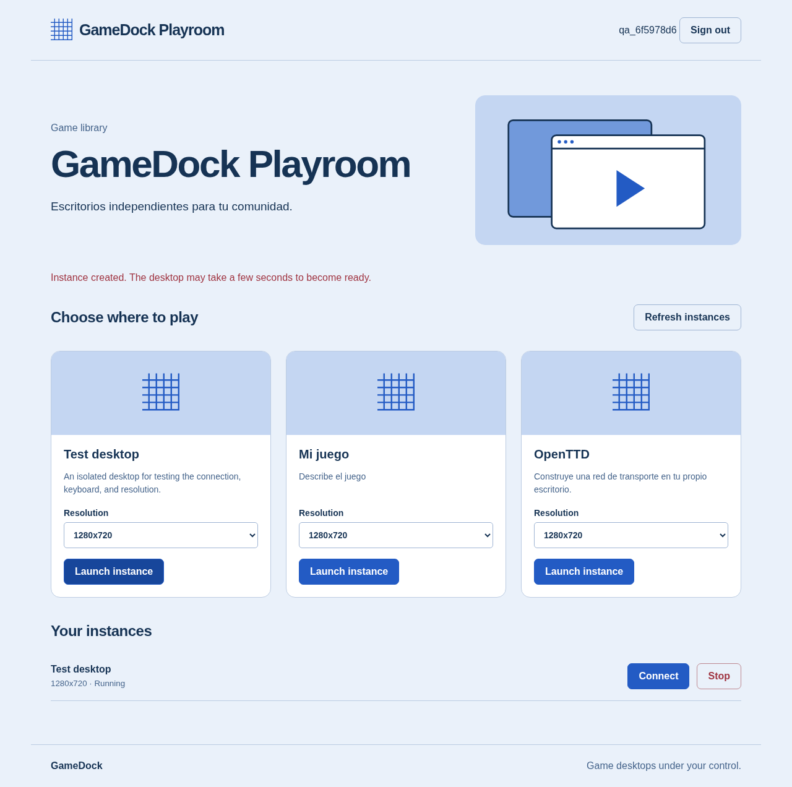

# GameDock

A framework for serving game desktops through a browser, with independent
accounts, configuration, and isolated game instances.

Includes registration, sign-in and sign-out, a bootstrap administrator, an editable
game catalog, platform name and banners, per-game resolutions, global and per-user
limits, account management, instance termination, and a CLI. Each instance runs a
command in its own container. The portal authenticates HTTP and WebSocket access
to Xpra; session containers do not publish ports to the host.

## Screenshots

OpenTTD running through the browser:



Game library:



## Getting started

For a local demo with OpenTTD included, run:

```sh
./scripts/start-local.sh
```

The script creates `.env` with a random administrator password if it does not
exist, builds the runtime and game images, starts the portal, waits for its health
check, and registers OpenTTD. Open `http://localhost:8080` and use the credentials
in `.env`. Create an invitation in Administration before registering a player
account. Repeating the command preserves existing credentials and data and updates the bundled OpenTTD profile. All application
dependencies run in Docker; the host needs Docker Engine, Docker Compose, and
Bash. On macOS, Docker Desktop or OrbStack provides the Linux environment.

### Initial administrator credentials

After running `./scripts/start-local.sh`, the initial username is `admin` and a
random password is saved as `ADMIN_PASSWORD` in `.env` at the repository root.
To display the credentials locally:

```sh
sed -n '/^ADMIN_USER=/p; /^ADMIN_PASSWORD=/p' .env
```

Use those values in the sign-in form at `http://localhost:8080`. Keep `.env`
private; it is excluded from Git. The administrator is created only when the
database is initialized. Editing `.env` later does not reset an existing
administrator's password. If `.env` already existed before running the script,
its credentials are preserved. You can also create a regular account through
the sign-in screen using an invitation code; only administrators can edit settings
and game profiles.

### Manual setup

Requirements: a Linux server with Docker Engine 26+ and Docker Compose. Tested on
x86_64. Serving the platform does not require Wine or Python on the host.

```sh
git clone git@github.com:HectorPulido/gamedock.git
cd gamedock
cp .env.example .env
# Edit .env: ADMIN_PASSWORD must contain at least 12 characters.
docker build -t gamedock-runtime:local runtime
docker compose up -d --build
```

Open `http://localhost:8080` and sign in with `ADMIN_USER` and `ADMIN_PASSWORD`.
The administrator is created on the first startup; changing `.env` does not change
existing passwords. The initial library includes an xterm desktop for testing
display, keyboard, and mouse input. Use Administration to change the name, welcome
message, banner image, registration policy, limits, game profiles, and account status.

For remote access, set `PUBLIC_URL` to the exact public HTTPS origin and place an
HTTPS proxy in front of the portal. Preserve paths and query strings and allow
WebSocket upgrades (Upgrade/Connection). Cookies use Secure when `PUBLIC_URL` uses
HTTPS. By default, the portal binds only to loopback. Do not expose session ports
or the Docker socket. Administrators are trusted operators: they select images
and commands, and the portal has access to the Docker daemon.

## Launch an instance from the command line

The CLI requires Python 3 and has no additional dependencies.

```sh
python3 cli/gamedock.py --url http://localhost:8080 register player --invite INVITATION_CODE
python3 cli/gamedock.py login player
python3 cli/gamedock.py launch desktop
python3 cli/gamedock.py list
python3 cli/gamedock.py stop INSTANCE_ID
python3 cli/gamedock.py logout
```

`launch` prints the instance ID and desktop URL. Sign in to the browser with the
same account to connect. Players use the administrator-configured resolution;
`--resolution` is available only to administrators. Passwords are prompted for rather than passed as command
arguments. CLI tokens expire after 24 hours and are stored with permissions 0600
in `~/.config/gamedock/session.json`. Use `GAMEDOCK_URL` or `--url` to select the
server and `--credentials` to maintain separate sessions.

## Add a game

Derive an image from `gamedock-runtime:local`, install the program, and keep the
`player` user (UID 1000). The working directory is `/data`, persisted per account
and game. As an administrator, choose **Administration → Games → Add game** to open a
new JSON template. Give it a unique `id`, set its name, installed Docker image,
launch command, resolutions, and limits, then click **Save game**. Click **Edit**
on an existing game card to load its JSON definition. **New game** resets the
editor to a fresh template. Saving an existing ID updates that game; saving a new
ID creates a game. The image must already be built or pulled on the server;
adding a profile does not download it.

Alternatively, create a profile through the CLI as an administrator:

```json
{
  "id": "my-game",
  "name": "My game",
  "description": "A game for your community",
  "banner": "https://example.com/banner.jpg",
  "image": "my-game:local",
  "command": ["/opt/game/start", "--server", "example.com"],
  "resolutions": ["1280x720", "1920x1080"],
  "default_resolution": "1280x720",
  "max_per_user": 1,
  "enabled": true,
  "env": { "LANG": "en_US.UTF-8" }
}
```

```sh
python3 cli/gamedock.py profile my-game.json
python3 cli/gamedock.py launch my-game --resolution 1280x720
```

`command` is an argument list with no implicit shell interpretation. If a shell
is needed, administrators can explicitly specify `["sh", "-c", "your command"]`.
Build or pull the image on the server before launching; GameDock does not pull
images automatically. Per-game banners are optional HTTP(S) image URLs. The
platform supports a welcome message and a banner image. Launch commands, images,
and environment variables are visible only to administrators. Do not use profile
environment variables to store individual users' secrets.

The runtime uses Xvfb, Openbox, and Xpra without audio. It supports X11 applications
and games compatible with software rendering. GPU access, controllers, audio,
anti-cheat, and 3D acceleration require adapting the image and device policy;
compatibility with every game is not guaranteed. Initial per-session limits are 4 GiB of RAM, 2 CPUs, and 256 processes.
Administrators can change RAM and CPU under **Administration → Platform →
Session resources**. RAM is entered in MiB (1024 MiB = 1 GiB); CPU accepts fractions
such as 0.5 or 0.75. Each game's editor also has **Game RAM** and **Game CPU**
controls. Leave them blank to inherit the platform defaults, or set `memory_mb`
and `cpus` in the game's JSON profile. Resource changes apply to new instances;
running games retain their existing limits. Players cannot override these values.
RAM accepts 128–1048576 whole MiB and CPU accepts 0.1–256; choose values your
Docker host can support. The process limit remains 256.

### Ready-to-play example: OpenTTD

```sh
docker build -t gamedock-openttd:local examples/openttd
./bin/gamedock profile examples/openttd/profile.json
./bin/gamedock launch openttd --resolution 1280x720
```

Includes the free game and OpenGFX graphics from Fedora repositories, without
requiring commercial client files. Configuration and saved games are stored in
`/data`. `./bin/gamedock` accepts all CLI commands listed above.

### Minecraft and Windows

`examples/minecraft/` provides an image and profile for a Linux Java launcher.
Supply your client or launcher with its libraries and resources at
`examples/minecraft/client/launcher.jar`. It must open a graphical interface and
support Java 21; adapt the command if it uses a different format. No client is
included, and authentication and licensing are not bypassed. This is not a
universal official launcher configuration.

```sh
docker build -t gamedock-minecraft:local examples/minecraft
python3 cli/gamedock.py profile examples/minecraft/profile.json
python3 cli/gamedock.py launch minecraft --resolution 1280x720
```

`examples/wine/` provides a Windows adapter. Put the game files in
`examples/wine/client/`, adjust `Game.exe`, build `gamedock-wine:local`, and import
its `profile.json`. The Wine prefix is persisted at `/data/wine`.

## Persistence and operation

### Player desktops and toolbar

Launching a game as a player opens its desktop automatically in the same tab.
The game is centered and scaled proportionally to fill the available space,
including enlarging it on bigger screens, without changing its configured
resolution. **View → Original size** prevents enlargement (small windows still
scale down to keep the whole desktop visible); the choice is remembered in the
browser. **Fullscreen** opens the viewer and its navigation in fullscreen, and
**Exit fullscreen** or Escape returns to the page. Browsers without fullscreen
support hide the button. Scaling preserves aspect ratio, so screens with a
different shape can retain margins; it does not resize windows inside the game. The top bar shows running
instances, **Previous instance**, **Back to library**, and **Stop instance**.
Returning to the library or changing instances disconnects the viewer and keeps
the game running. Stopping an instance requires confirmation and preserves its
saved files. Stopped instances are hidden from the library; history remains in
the API and database.

Use **Administration → Platform → Show desktop toolbar** to show or hide
Xpra's floating controls. Changes apply to open viewers within 15 seconds and do
not require rebuilding images or restarting games. `DESKTOP_TOOLBAR` in
`server/app.py` supplies the initial default when no administrator preference has
been saved. Hiding the toolbar changes the interface, not the underlying Xpra
features.

### Platform name and appearance

Under **Administration → Platform**, change **Name** to the public name
of your server. It appears in the header, page title, welcome heading, footer,
and desktop viewer, including the initial HTML before JavaScript loads.

**Administration → Appearance** provides three starting themes: **Classic**
(light blue), **Midnight** (dark), and **Forest** (green). Customize page, card,
text, accent, border, focus and viewer colors; font; corner radius; content
width; logo; background image; and footer message. Existing banner settings
remain under Platform. Image fields take HTTP(S) URLs.

Use **Preview** to try appearance changes in your current page, **Discard preview**
to return to the saved settings, and **Save appearance** to publish the appearance
for all visitors. **Reset to preset** clears overrides, assets and custom CSS in
the preview; save to keep the reset. Choosing another theme replaces the palette
while preserving the other controls. **Advanced customization** supports custom
CSS for all three surfaces and JSON import/export for reusable appearances.
Imported files populate the controls and require saving before affecting visitors.

Appearance is stored in SQLite and survives portal recreation. Other visitors
receive it on their next page load; open desktop viewers refresh it within
15 seconds. Custom CSS is an administrator capability: it can change or hide any
interface element. To recover from a bad stylesheet, update the authenticated
API with `PUT /api/admin/settings` and `{"appearance": {}}`. API appearance writes
replace the appearance object; omitted values fall back to the selected preset.

### Invitations and player limits

Registration requires an invitation by default. Under **Administration →
Access**, create a code with a label, usage limit, and expiration. Copy it
when it is shown: only its hash is stored, and it cannot be displayed again.
Share it with the player, who enters it in the registration form or uses the CLI
`register --invite CODE` option. Used-up, revoked, and expired codes are rejected.
Existing accounts can still sign in without a code. Disable **Require an
invitation code** for open registration, or disable **Allow account registration**
to close registration entirely.

The platform limits total concurrent instances and instances per account. Each
game also has an availability switch, a per-player instance cap (0 blocks access),
and a fixed player resolution. Under **Accounts → Game access and instance
limits**, override an account's total allowance and specify how many instances of
each game it may launch. With an explicit game list, games not on the list are
blocked. Inheriting library access applies the default limits to current and new
games. The most restrictive platform, account, and game limits apply; changes
restrict future launches without interrupting current games. Administrators may
choose from a game's configured resolutions and bypass game access restrictions,
but still obey the platform's global and per-account concurrent limits.

### Session networks

Game networks are internal by default: the portal can reach each desktop, but
games cannot reach the Internet or sibling game networks. This also preserves
isolation when using OrbStack for the local demo. For a game that needs downloads,
authentication, or online multiplayer, set `internet_access: true` in its JSON profile. Use a native Linux Docker host
for Internet-enabled games: OrbStack permits traffic between ordinary bridges,
so separate non-internal networks alone do not provide sibling isolation there.
Network changes apply to newly launched instances.

### Inactivity cleanup

**Stop inactive instances after (minutes)** defaults to 30; 0 disables cleanup.
Mouse, touch, wheel, and keyboard input in the player page update the instance's
activity timestamp. An idle tab, a connected WebSocket, and game animation do not
keep it alive. Each instance has its own timer, including background instances.
The player warns during the final minute; the server checks every 15 seconds and
stops expired instances while retaining their saved files. Timestamps and settings
persist across portal restarts. Unsubmitted progress inside the game can be lost
when an inactive instance stops; choose a timeout appropriate for the game.

- The `gamedock_gamedock-data` volume stores SQLite data: accounts, scrypt password
  hashes, revocable tokens, profiles, configuration, and instance history.
- `NAMESPACE-user-UID-GAME` persists `/data`. The namespace defaults to the Compose
  project name (`gamedock`). Set `GAMEDOCK_NAMESPACE` explicitly using 1–40 lowercase
  letters, digits, underscores, or hyphens. Keep it stable and use distinct names
  for deployments that must not share files. Multiple sessions for the same
  account and game share files. For games that lock their profiles, set the
  per-user limit to 1 or use separate profiles. Save before stopping an instance:
  stopping removes the container but preserves its volume.
- State is reconciled with Docker when listing or creating instances. Recreating
  the portal preserves desktops and accounts. Signing out revokes desktop access
  without terminating the game. Disabling an account revokes its tokens and
  terminates its instances.
- `docker compose logs -f portal` shows operational errors without printing tokens
  or passwords. Stop instances through Administration before removing the
  platform: `docker compose down` stops the portal, not its session containers.
- Back up SQLite consistently along with game volumes. Do not commit `.env`,
  databases, tokens, or game clients. Source files and build instructions are
  fully defined by the repository.

## API

Mutations require `Content-Type: application/json`; send `{}` for requests with no
fields. Authenticate with an HttpOnly cookie or `Authorization: Bearer TOKEN`.
Do not put tokens in URLs. Other users' instances return 404; administrators can
manage all instances.

| Method     | Route                                   | Purpose                                                       |
| ---------- | --------------------------------------- | ------------------------------------------------------------- |
| GET        | `/api/catalog`                          | Public settings, account, and games                           |
| POST       | `/api/auth/register`, `/api/auth/login` | `{username, password}`                                        |
| POST       | `/api/logout`                           | Revoke the current session                                    |
| GET / POST | `/api/instances`                        | List / create with `{game, resolution}`                       |
| DELETE     | `/api/instances/ID`                     | Stop an instance                                              |
| GET        | `/play/ID`                              | Centered player and instance navigation                       |
| POST       | `/api/instances/ID/activity`            | Record user input for inactivity cleanup                      |
| GET        | `/api/instances/ID`                     | Owned instance status and dimensions                          |
| GET / WS   | `/desktop/ID/…`                         | Authenticated desktop access                                  |
| PUT        | `/api/admin/settings`                   | Name, banners, registration, limits                           |
| PUT        | `/api/admin/games`                      | Create or replace a profile                                   |
| DELETE     | `/api/admin/games/ID`                   | Remove a profile                                              |
| GET        | `/api/admin/users`                      | List accounts                                                 |
| PATCH      | `/api/admin/users/ID`                   | `{enabled: true/false}` or `{policy: {max_instances, games}}` |
| GET / POST | `/api/admin/invitations`                | List metadata / create an invitation                          |
| DELETE     | `/api/admin/invitations/ID`             | Revoke an invitation                                          |

## Validation

Run the complete suite on Linux using only the dedicated Docker QA project:

```sh
./scripts/qa.sh
```

Requires Python 3 and Docker Compose with `--wait`. QA credentials remain outside
the repository, and screenshots are written to `/tmp/gamedock-artifacts`. The
suite verifies that recreating the portal does not restart games and that volumes
survive instance replacement. Run browser tests sequentially on a stable Docker
network; do not use host networking while creating session networks.

```sh
docker build -t gamedock-portal:local .
docker run --rm -v "$PWD:/app:ro" gamedock-portal:local python -m unittest discover -s tests -v
```

`tests/live.py` checks the API and CLI, native commands, two real desktops, Xvfb
resolutions, persistence, proxying, isolation, and port exposure. Run it on the
host with Python 3 and the Docker CLI against a disposable QA deployment at
localhost:18088. It reads bootstrap credentials from `/tmp/gamedock-qa.env`.
Do not run it against real accounts. `tests/browser.py` checks registration,
launching, rendered desktop pixels, real keyboard input, WebSocket revocation,
termination, and mobile layout. `tests/game_browser.py` checks administration
forms, game creation, invitations, player access, live toolbar settings, and a
real OpenTTD session. `tests/idle_live.py` verifies the actual inactivity worker
against a Docker instance with a one-minute timeout. Build the browser environment
with `tests/Dockerfile.browser`; screenshots are written to `/artifacts`. The QA
portal uses `PUBLIC_URL=http://gamedock-qa-portal-1:8080`, passed to the browser as
`QA_URL`; the QA CLI connects through loopback:18088.

`tests/customization_browser.py` verifies public branding, all three themes,
preview isolation, logo and CSS, appearance import/export, inherited and per-game
resource limits in actual Docker containers, mouse/keyboard through an enlarged
viewer, fixed Xvfb resolution, fullscreen entry/exit, and mobile layout. It uses
the same disposable QA deployment and browser environment as the other suites.

### Administrator workspace

Players and administrators share the same library and automatic game launch. The only extra control for administrators is **Administration**, which opens the protected `/admin` page. The library shows only your own instances.

The workspace separates **Access**, **Games**, **Platform**, **Appearance**, and **Instances**. Search accounts, game profiles, or active instances; section links can be bookmarked, and switching sections preserves unsaved form values. Administrators can launch a game with a selected test resolution from **Games**.

### Streaming quality and responsiveness

Open **Administration → Streaming** to adjust picture quality, capture rate,
bandwidth, compression, codecs, shared-memory capture and input latency. The
27 controls include all optimizations adapted from Dofus: short frame queues,
immediate TCP delivery, XSHM capture and recovery after browser inactivity.
Encoder downscaling is disabled by default. Expanding the viewer still leaves
the game resolution unchanged.

Presets fill the form without saving: **Balanced**, **Sharp picture**, **Dofus
low latency**, and **Lossless picture**. Save to use the chosen values for new
instances. Active instances keep their original configuration. Codec choices
are negotiated with the browser; explicit encoder choices require those codecs
in the runtime image. Lossless PNG/RGB preserves detail but uses more bandwidth.

Game profiles can override individual values in their JSON definition:

```json
"streaming": {
  "quality": 95,
  "min_quality": 85,
  "refresh_rate": 30,
  "bandwidth_mbps": 0
}
```

An empty `streaming` object inherits all platform defaults. API writes to
`/api/admin/settings` merge `streaming` values; game profile writes replace their
overrides. Quality and speed use 0 for automatic adjustment; bandwidth uses
0 for no fixed limit. Queue values must satisfy minimum ≤ initial ≤ maximum.

Rebuild `gamedock-runtime:local` and game images derived from it when upgrading
the runtime. Merely rebuilding the portal cannot update Xpra inside an existing
image. The idle recovery patch checks its source targets during the build and
fails explicitly if a future Xpra version needs a different patch.

### Floating notifications

Status messages and errors appear as small floating notifications, adapted from
the Dofus portal. They can be dismissed, expire automatically and pause while
hovered or focused. Notifications follow the selected theme and remain visible
in fullscreen without resizing the game or capturing its keyboard focus.
Repeated polling errors and inactivity warnings are deduplicated. An ended
session shows a clear return-to-library state instead of a blank iframe.

### Viewer diagnostics and scaling

The player offers fit, original-size and integer scaling, plus smooth/crisp canvas
filters. These change presentation, not the source resolution or missing detail.
Administration → Streaming sets defaults, automatic keyboard-focus recovery,
diagnostics availability and the sample interval (1–10 seconds). Viewer scale
and filter choices are remembered locally; Server defaults resets them.

Open Diagnostics to compare successful capture reads, capture-loop frequency,
received Xpra frame boundaries and decode acknowledgements. Partial updates are
counted separately; these are transmission measurements, not game-engine FPS.
A static screen may legitimately send few updates. Image Mbps and projected
GB/hour count image payload only, excluding audio, protocol and TLS overhead.
CPU separates game processes from Xpra/display processes; 100% is one core.
Memory sums process RSS and may count shared pages more than once. Statistics
requests stop when the panel closes or the tab is hidden. Capture instrumentation
requires a newly launched instance from the rebuilt runtime image.

Portal HTML references a single content-versioned CSS/JS bundle frozen at startup.
Versioned assets are immutable; unavailable old versions return 410 and require
a reload, preventing a page from silently combining incompatible asset versions.

### CPU graphics by default and optional Linux GPU runtimes

The standard runtime uses Mesa llvmpipe for OpenGL rendering on the CPU, including
on Mac Docker. Applications keep their normal command. **Games → CPU rendering
threads** accepts 0 for automatic workers based on the container CPU quota
(capped at 16), or 1–64 for an explicit value. Increase the game's CPU allocation
to give rendering more CPU time. This provides software OpenGL compatibility;
it cannot promise GPU-level performance or speed up every 2D game. Diagnostics
shows the actual renderer and configured workers.

Run `./scripts/build-gpu.sh` to build separate NVIDIA, AMD and Intel variants.
Select graphics acceleration, device and host group IDs in **Administration →
Games**, using a game image derived from the matching GPU runtime. Existing
CPU-only profiles continue to work. The runtime verifies hardware OpenGL before
launching and reports its renderer in Diagnostics. Rendering acceleration does
not automatically enable hardware video encoding.

See [GPU setup, demo Compose and game profiles](examples/gpu/README.md) for host
drivers, permissions, test commands and compatibility limits. Physical GPU
validation requires a Linux GPU host; OrbStack on this Mac has no GPU passthrough.

For HTTPS / browser H.264 decoding, effective bandwidth budgets and Wine process
accounting, see [streaming deployment notes](examples/https/README.md).
